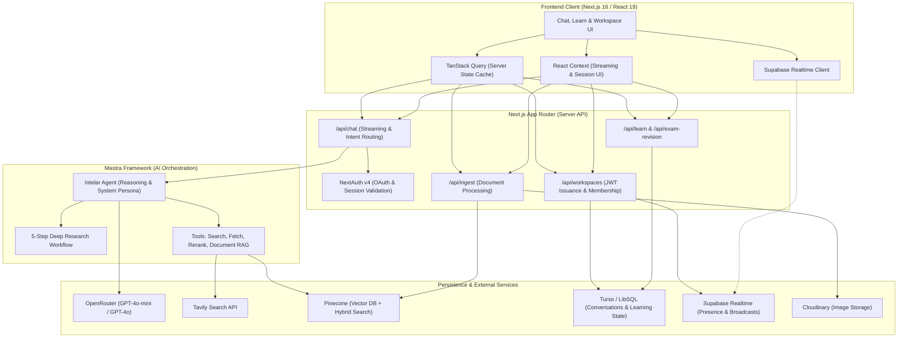

<div align="center">
  <h1>🔍 Intelar</h1>
  <p><strong>A full-stack AI research agent, document intelligence engine, and adaptive learning platform.</strong></p>
  <p>
    
    
    
    
  </p>
</div>

---

## 📖 What is Intelar?

**Intelar** is an agentic research and learning platform designed to bridge the gap between unstructured web exploration, personal document libraries, and structured educational mastery.

Traditional chatbots often hallucinate, lose long-term context, and provide answers without traceable sources. When users want to study or deeply understand complex topics, they are forced to manually piece together web searches, textbooks, and notes.

Intelar transforms this entire workflow by uniting:
1. **Autonomous Web Research**: A multi-step pipeline that independently plans sub-queries, crawls live web pages, scores domain credibility, and synthesises cited reports.
2. **Document Intelligence (Hybrid RAG)**: The ability to upload documents (PDF, DOCX, CSV, TXT, images) and chat with them using vector embeddings, keyword overlap, and MMR deduplication.
3. **Adaptive Learning & Exam Simulation**: Converting raw notes or missed exam questions into bite-sized, interactive study paths with verified explanations, untimed retries, and offline study packs.
4. **Collaborative Team Workspaces**: Shared team spaces where groups can organize research, share document vaults, and summon `@Intelar` for contextual AI assistance in real-time.

---

## ✨ Core Features

### 🔎 1. Autonomous Deep Research
- **Dynamic Intent Routing**: Fast conversational queries receive instant answers, while complex questions trigger Intelar's multi-step deep research workflow.
- **5-Step Research Pipeline**:
  1. **Plan**: Decomposes intricate questions into 2–3 targeted research sub-queries.
  2. **Gather**: Executes real-time searches via the Tavily API with rate-limiting courtesy delays.
  3. **Deep-Fetch**: Scrapes and parses the top source URLs, stripping away HTML boilerplate and extracting core prose.
  4. **Rerank**: Evaluates every source using TF-IDF text relevance combined with domain credibility scoring.
  5. **Synthesise**: Formulates an exhaustive, objective response backed by verifiable inline `[Source](URL)` citations.

### 📄 2. Hybrid Document RAG
- **Multi-Format Ingestion**: Supports `.pdf`, `.docx`, `.csv`, `.txt`, `.md`, and image formats (`.png`, `.jpg`, `.webp`).
- **Semantic Chunking**: Breaks documents down at natural paragraph and sentence boundaries for optimal retrieval granularity.
- **Hybrid Search**: Combines 70% vector similarity (`all-MiniLM-L6-v2`) with 30% keyword overlap, applying Maximal Marginal Relevance (MMR) to eliminate redundant chunks.
- **Image Intelligence**: Direct image OCR and multimodal perception powered by OpenRouter vision models.

### 🎓 3. Interactive Learning & Exam Prep
- **Curated Study Paths**: Transform up to three resource files into a structured 3–5 lesson syllabus.
- **Micro-Lessons & Practice**: Each lesson pairs key concepts with traceable source excerpts and 3 multiple-choice check questions with hints and explanations.
- **Exam Simulation & Revision Plans**: Practice under timed conditions; missed questions can be instantly converted into a targeted revision module with verified source excerpts.
- **Offline Study Packs & Sync**: Download learning materials for offline study. Progress made offline reconciles seamlessly without duplicate submissions upon reconnection.

### 👥 4. Team Workspaces & Live Collaboration
- **Shared Document Vaults**: Organize resources and research records within private, invite-only team workspaces.
- **Collaborative Group Chat**: Discuss findings in real time with colleagues, inviting `@Intelar` to synthesize group context and answer shared queries.
- **Real-Time Presence**: Live typing indicators, presence, and message broadcasts powered by Supabase Realtime channels with zero periodic client polling.

### ⚡ 5. Modern UX & Performance
- **Token-by-Token Streaming**: Instant feedback with fluid markdown streaming, syntax highlighting, and collapsible source drawers.
- **Persistent Multi-Turn Memory**: Conversation history persists in Turso (LibSQL), organized per user.
- **Accessible & Responsive**: Fully responsive from 360px mobile screens up to desktop displays, with full light/dark mode support and respect for reduced-motion preferences.

---

## 🏗️ System Architecture

Intelar is built as a modular, full-stack TypeScript application where the Next.js App Router coordinates presentation and authorization, Mastra powers agent reasoning and deterministic workflows, and resilient external services handle embeddings, vector search, persistence, and real-time messaging.

### Architecture Overview



### Core Architectural Layers

1. **Presentation & State Management**:
   - **TanStack Query** manages server state (user conversations, resource collections, study paths) with automatic invalidation and optimistic updates.
   - **React Context** manages ephemeral state: active chat streams, draft inputs, sidebars, and theme preferences.
   - Direct `fetch` streams power token delivery and multipart file uploads.

2. **Agentic Layer (Mastra Framework)**:
   - Configured in `src/mastra/index.ts`, Mastra decouples AI business logic from API handlers.
   - The **Intelar Agent** utilizes custom instructions enforcing strict citation behavior, neutral tone, and tool routing.
   - The **Research Workflow** deterministically steps through `plan → gather → deep-fetch → rerank → synthesise`, preventing agent drift during complex multi-hop investigations.

3. **Hybrid Retrieval-Augmented Generation (RAG)**:
   - Ingestion extracts and normalizes text from PDFs, DOCX, CSVs, and TXT files.
   - Vectors are generated using HuggingFace's `sentence-transformers/all-MiniLM-L6-v2` and indexed in Pinecone under user/conversation namespaces.
   - Queries execute hybrid scoring (70% dense vector similarity + 30% sparse keyword matching) with Maximal Marginal Relevance (MMR) deduplication.

4. **Persistence & Real-Time Sync**:
   - **Turso (LibSQL)** provides durable, low-latency relational persistence for users, messages, resource records, and exam revision attempts.
   - **Supabase Realtime** delivers sub-second message broadcasts and presence in collaborative workspaces via ephemeral, member-scoped ES256 JWT tokens issued by Next.js.

---

## 🛠️ Tech Stack

| Layer | Technology | Purpose |
|---|---|---|
| **Framework** | [Next.js 16](https://nextjs.org) | App Router, Server Actions, Route Handlers, Turbopack |
| **Language** | [TypeScript 5](https://www.typescriptlang.org/) | Strict static typing across client, server, and agents |
| **AI Orchestration** | [Mastra](https://mastra.ai) | Declarative agent loops, structured workflows, memory, and tools |
| **LLM Provider** | [OpenRouter](https://openrouter.ai) | Default model: `openai/gpt-4o-mini` (configurable) |
| **Vector DB** | [Pinecone](https://pinecone.io) | Multi-tenant vector index with metadata filtering |
| **Embeddings** | HuggingFace Inference | `sentence-transformers/all-MiniLM-L6-v2` |
| **Relational DB** | [Turso](https://turso.tech) (LibSQL) | Serverless SQLite for conversation and learning data |
| **Realtime** | [Supabase Realtime](https://supabase.com) | Presence and live broadcasts for workspaces |
| **Web Search** | [Tavily API](https://tavily.com) | Real-time web search and page content extraction |
| **Media Storage** | [Cloudinary](https://cloudinary.com) | Image and attachment hosting |
| **Authentication** | [NextAuth v4](https://next-auth.js.org) | Secure OAuth with Google and GitHub |
| **UI Components** | Tailwind CSS v4, shadcn/ui, Lucide | Modern, accessible, responsive component library |

---

## 📁 Directory Structure

```
src/
├── app/
│   ├── page.tsx                     # Landing page introducing Intelar
│   ├── chat/page.tsx                # Main AI research chat interface
│   ├── c/[id]/page.tsx              # Persistent conversation view
│   ├── learn/                       # Learning paths & practice quizzes
│   ├── workspaces/                  # Collaborative team workspaces
│   ├── resources/                   # Document library & file management
│   ├── settings/                    # User preferences & data management
│   └── api/
│       ├── chat/route.ts            # Streaming chat handler (RAG / Research Workflow)
│       ├── ingest/route.ts          # Document parsing → Pinecone vector indexing
│       ├── upload/route.ts          # Media upload to Cloudinary
│       ├── conversations/           # Conversation CRUD operations
│       ├── learn/                   # Study paths and attempt synchronization
│       ├── exam-revision/           # Missed-question revision generator
│       └── workspaces/              # Workspace creation, invites, and tokens
├── components/
│   ├── chat-window.tsx              # Message timeline renderer
│   ├── chat-input.tsx               # Multimodal input bar with attachments
│   ├── message-bubble.tsx           # Markdown renderer with citation popovers
│   ├── resources-library.tsx        # Searchable document repository grid/list
│   ├── workspace-chat.tsx           # Real-time team collaboration view
│   ├── query-provider.tsx           # TanStack Query client configuration
│   └── sidebar.tsx                  # Historical conversations and navigation
├── lib/
│   ├── auth.ts                      # NextAuth configuration & callbacks
│   ├── db.ts                        # Turso/LibSQL database client
│   ├── vector-store.ts              # Pinecone hybrid search + MMR deduplication
│   ├── embeddings.ts                # HuggingFace embedding utilities
│   ├── document-processor.ts        # PDF, DOCX, CSV, TXT parsers & chunkers
│   ├── queries/                     # TanStack Query keys & API request functions
│   └── temporal/                    # Freshness policy & query intent classifiers
└── mastra/
    ├── index.ts                     # Mastra framework initialization
    ├── agents/
    │   ├── intelar-agent.ts         # Primary research & chat agent
    │   └── intelar-instructions.ts  # System prompts, persona & guardrails
    ├── tools/
    │   ├── web-search-tool.tsx      # Tavily search integration
    │   ├── web-fetch-tool.ts        # Prose-focused page scraper
    │   └── source-rerank-tool.ts    # TF-IDF & domain credibility scorer
    └── workflows/
        └── research-workflow.ts     # 5-step deep research pipeline
```

---

## 🚀 Getting Started

### Prerequisites

- **Node.js**: `v22.13.0` or higher
- **Accounts & API Keys** (free tiers available):
  - [OpenRouter](https://openrouter.ai) — LLM completions
  - [Pinecone](https://pinecone.io) — Vector database
  - [Turso](https://turso.tech) — LibSQL database
  - [Tavily](https://tavily.com) — Web search
  - [Cloudinary](https://cloudinary.com) — Attachment storage
  - [Supabase](https://supabase.com) — Workspace realtime channels
  - Google or GitHub Developer account — NextAuth credentials

### 1. Clone & Install

```bash
git clone https://github.com/daviddozie/intelar.git
cd intelar
npm install
```

### 2. Configure Environment Variables

Create `.env.local` by copying the example file:

```bash
cp .env.example .env.local
```

Populate the required configuration keys:

| Variable | Description | Where to Get It |
|---|---|---|
| `OPENROUTER_API_KEY` | Access key for LLM models | [OpenRouter Keys](https://openrouter.ai/keys) |
| `OPENROUTER_MODEL` | Default LLM (default: `openai/gpt-4o-mini`) | [OpenRouter Models](https://openrouter.ai/models) |
| `TAVILY_API_KEY` | Search API key | [Tavily Dashboard](https://tavily.com) |
| `PINECONE_API_KEY` | Vector database API key | [Pinecone Console](https://app.pinecone.io) |
| `PINECONE_INDEX` | Index name (e.g. `intelar`) | Pinecone Dashboard |
| `PINECONE_HOST` | Index host URL | Pinecone Dashboard |
| `TURSO_DATABASE_URL` | LibSQL connection URL (`libsql://...`) | [Turso Console](https://turso.tech) |
| `TURSO_AUTH_TOKEN` | Turso database authentication token | Turso Console |
| `CLOUDINARY_CLOUD_NAME` | Cloudinary cloud name | [Cloudinary Console](https://cloudinary.com/console) |
| `CLOUDINARY_API_KEY` | Cloudinary API key | Cloudinary Console |
| `CLOUDINARY_API_SECRET` | Cloudinary API secret | Cloudinary Console |
| `NEXTAUTH_SECRET` | NextAuth encryption secret | Generate with `openssl rand -base64 32` |
| `NEXTAUTH_URL` | Application base URL (`http://localhost:3000`) | Local or deployed URL |
| `GOOGLE_CLIENT_ID` / `_SECRET` | Google OAuth app credentials | [Google Cloud Console](https://console.cloud.google.com) |
| `GITHUB_CLIENT_ID` / `_SECRET` | GitHub OAuth app credentials | [GitHub Developer Settings](https://github.com/settings/developers) |
| `NEXT_PUBLIC_SUPABASE_URL` | Supabase project URL | Supabase Dashboard |
| `NEXT_PUBLIC_SUPABASE_PUBLISHABLE_KEY` | Supabase publishable key | Supabase Dashboard |
| `SUPABASE_SECRET_KEY` | Supabase server secret key | Supabase Dashboard |
| `SUPABASE_REALTIME_JWT_KID` | Key ID for ES256 JWT tokens | Supabase Auth → JWT Signing Keys |
| `SUPABASE_REALTIME_JWT_PRIVATE_JWK` | Private ES256 JWK string | Server-only private signing key |

### 3. Database & Realtime Setup

1. **Turso**: Ensure your database is created:
   ```bash
   turso db create intelar
   turso db tokens create intelar
   ```
2. **Supabase Realtime**: Apply the migration in `supabase/migrations/20260929000000_workspace_realtime.sql` via the Supabase SQL Editor to authorize private workspace channels.

### 4. Run Locally

```bash
# Start Next.js web application (http://localhost:3000)
npm run dev

# Or start both Next.js and Mastra Studio concurrently
npm run dev:all
```

---

## 📦 Available Scripts

| Script | Purpose |
|---|---|
| `npm run dev` | Start the Next.js development server with Turbopack |
| `npm run mastra` | Launch Mastra Agent Studio at `localhost:4111` |
| `npm run dev:all` | Run Next.js and Mastra Studio concurrently |
| `npm run build` | Compile and build the Next.js production bundle |
| `npm run start` | Start the compiled production server |
| `npm run lint` | Run ESLint across all codebase files |
| `npm run check:foundation` | Run automated foundation and database tests |
| `npm run check:learning` | Verify learning path creation and quiz loop logic |
| `npm run check:offline` | Test offline study pack downloads and attempt sync |
| `npm run check:revision` | Test exam revision plan generation and validation |
| `npm run check:seo` | Validate canonical URLs, robots.txt, and metadata tags |

---

## 🤝 Contributing

Contributions are welcome! Please read [CONTRIBUTING.md](./CONTRIBUTING.md) for guidelines on code style, branch management, and submitting pull requests.

---

## 📄 License

This project is licensed under the Apache License 2.0 / MIT. See [LICENSE](./LICENSE) and [NOTICE](./NOTICE) for details.
